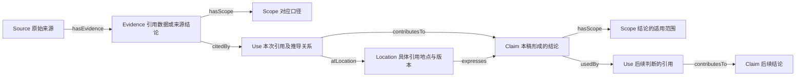

# 证据关系图谱

研究取得可引用内容后开始记录，稿件审计和改稿时使用。沿用现有 Source ID、Claim ID 和交付清单；在清单的 `trace_graph` 扩展中维护关系，TTL 与邻接表由脚本生成。当前 JSON 是唯一编辑入口。

## 1. 节点与指向



| 节点 | 唯一内容与粒度 |
|---|---|
| Source | 一个已取得或已定位的原始来源版本；沿用 `sources` 的元数据、访问状态、本地路径和哈希 |
| Evidence | 来源中的一项可独立引用的数据或结论；含原文摘录、原文位置与口径。同一报告的不同总体／时期拆开记录 |
| Scope | 地区、品类、用途、人群、时期、指标、单位、分母、渠道、数据属性；同口径可复用同一节点 |
| Use | 一次“该证据／上游结论，在此地点，被用于此结论”的关系；注明支持、反证或背景、推导理由与口径审查 |
| Location | 一个具体稿件、图表、工作簿或外部回读中的位置；绑定路径、哈希、页码及段／图／单元格定位 |
| Claim | 本稿形成的事实判断、计算结果、分析推断或建议；沿用 `claims[]`，增加 `scope_id` |
| Reference | 正文或书目中的一个来源链接；记录来源和实际位置。书目列示、未取得的报告线索与真正采用的证据分别登记 |
| SourceReview / UseReview | 返回原文重建口径的审查、以及对当前报告原句的适配审查；原文读取回执、字段锚点及判断随记录保存 |

Source 中的观点记录为 Evidence 的 `source_conclusion`，本稿推导的判断记录为 Claim。引用关系的角色由 Use 指明。`support` 才进入支持链；`contradict` 保留反证，`context` 记录背景。每个 Claim 须有支持路径；反证和背景的存在不会补齐支持链。

同一 Evidence 可被多次引用，同一 Claim 可使用多条证据，并在多个位置表达。位置自身不构成证据。上游 Claim 可经新的 Use 支持下游 Claim；支持关系不得循环。Excel 计算继续由 Claim 原有的 `excel`／`calculation` 记录及审计工具核验，图谱保留这段计算路径。

## 2. 清单扩展

新项目使用模板自带的以下结构。`project_id` 由 agent 首次生成并持久保存（如 UUID），后续版本沿用；同一事实的节点 ID 不随页序改变。节点按类型区分，例如 `Source:S1`、`Evidence:E1`、`Claim:C1`。

来源改版时建立新的 Source 版本节点；Evidence／Scope 含义改变时换节点 ID 或保留明确版本。当前清单维护本次有效关系，历史映射保留在当轮图谱快照。

```json
"trace_graph": {
  "schema_version": 1,
  "project_id": "项目内固定UUID",
  "units": {},
  "coverage_documents": [],
  "scopes": {},
  "evidence": {},
  "locations": {},
  "uses": [],
  "source_references": [],
  "source_grounding": {"schema_version": 1, "evidence_reviews": {}, "use_reviews": {}}
}
```

| 记录 | 字段 |
|---|---|
| `scopes[SC1]` | `geography, category, application, population, period, metric, unit, denominator, channel, data_status`；均写具体值。不适用项说明理由，未知项留空并进入缺口；可补币种／价格基期等字段 |
| `evidence[E1]` | `source_id, kind, quote, locator, scope_id`；kind 为 `datum` 或 `source_conclusion`，quote 是已读取原文的定位摘录；可加原值和标准化描述 |
| `locations[L1]` | `path, sha256, page, selector, kind`；kind 为 `text / visual / workbook / external_snapshot`。文本增加 `quote`；其他格式保留可核查的图号、Sheet／Range或平台块 ID |
| `uses[]` | `id, from, claim_id, location_id, role, rationale, scope_review`。from 为 `Evidence:E1` 或 `Claim:C1`；role 为 `support / contradict / context`；scope_review 为 `{status, basis, input_sha256}` |
| `claims[]` 新增项 | `scope_id`；其他 ID、主引用页、结论原句、计算等字段沿用既有定义 |
| 可选 `units` | 正式页以外的摘要、Notes、术语和附录单元；ID与正式页不重叠。它们同样接受完整图谱检查 |
| 可选 `source_references[]` | `id, source_id, location_id, purpose`；保存每个实际链接。`bibliography`只证明列入书目；尚未确认绑定用途用`unresolved_binding`，进入未验证项 |
| `coverage_documents[]` | 完整迁移/提交时登记实际客户稿的`path,sha256`；当前直接扫描Markdown/TXT原样链接。该模式下Reference另存`url_as_cited`，工具对照原稿与登记的URL次数并核对引用位置 |

`scope_review`保留为结构与输入变化检查，单独的verified和签名不能放行。必须按 [返回原文的实质审查](source-grounded-review.md) 完成source_grounding：先不看旧Scope答案，从原文独立重建来源口径，保存逐字段原句、原词与解释；再核对当前报告原句、目标范围和用途。SourceReview变化会使相关UseReview失效。默认图谱检查和trace/release要求这两层记录，缺记录或不支持时进入Needs review。含义与商业推导由agent实质判断，不能只填表。

旧scope_review.input_sha256继续绑定该次引用的原文版本、双方口径、结论和位置。文本位置按实际摘录绑定，其他段落改动不重开未变引用；来源或含义变化则回原文复核。source_grounding按含义生成引用审查键，多个展示位置可复用同一份真实审查。

新图谱模式下，`source_ids` 和 `source_checks` 从 Evidence 与 Use 路径生成供既有三流检查使用，不再逐 Claim 重复填写摘录。已存在这些字段时，工具核对它们与图谱一致。直接引用、计算与定性 Claim 均可使用图谱；每条 Evidence 保留自己的口径。

定位规则：来源原文的页／表写在 Evidence.locator；客户稿的页／段写在 Location.selector。一个 Location 绑定一个文件版本；外部引用地点保存真实回读文件和 revision／块 ID。正文、图、摘要和附录中同一结论的采用位置分别登记。文件换版后更新位置和哈希，旧图谱快照留在当轮检查目录。

提取文本合并同一文档的多个已取得页面时，在extraction增加`input_files=[{path,sha256},…]`，逐件固定输入版本；不能只绑定第一个文件，再把其他未固定页面混入摘录。工具逐件检查哈希，具体段落归属仍需审查。

文本引用可使用Page N/Total结构，也可在Location增加`section_heading`，按原始Markdown或飞书XML中的唯一标题定位。page仍使用正式页或补充单元ID。脚本核对原句出现在该章节；selector的段落、图号、单元格及原生图形内容继续人工核对。飞书回读采用自己的真实标题和版本，不能假定与本地稿标题相同。

同一报告版本被登记成多个Source ID时，人工核实原始出版物、版本和数据期后登记`same_document_group`及`identity_basis`。工具以`sameDocumentAs`联通别名影响查询；同一机构、同一摘录文件或同一动态URL不自动构成同一版本。来源独立性仍由`independence_group`和原始数据关系判断。

内部客户输入、项目定义和获取记录可分别标记`source_type=client_input/project_definition/research_process_record`及`citation_policy=internal`。保留原件/约定和审查依据；定义只证明本项目如何使用术语，获取记录只证明研究过程，不能替代独立市场证据。表头、导航和版式标签进入排除台账，不伪造支持链。审查新补的反证Use可标记`citation_policy=audit_only`，明确它是审查关联，客户原稿未引用它。

完整迁移/提交须登记coverage_documents，核对真实稿件的全部链接，同时核对图、工作簿、摘要和附录覆盖。未声明核对稿件时，网络只检查已有登记，无法发现从未登记的引用。其他格式记录等价核对，不把格式未支持视为已验证。三流检查在图谱模式下接受同一Part已核实的书目Reference及同版别名，也保留上游Claim的出处；不要求每个下游策略重复整份原始书目。

影响查询给出“需要复核的候选范围”。同一来源改动不意味着所有关联句子都要改；agent沿Evidence和Use判断哪些事实、结论或展示实际受到影响。独立事实尽量按国家×时期×指标×总体拆分，避免一个多国复合节点把局部变化扩散到所有地区。

## 3. Turtle 表达

词表见 [evidence-ontology.ttl](../assets/evidence-ontology.ttl)。采用 RDF/Turtle 的节点和谓词表达，来源派生关系使用 PROV-O。示意中的 ID 和文字仅用于解释结构：

```turtle
@prefix ma: <urn:market-analysis:ontology:> .
@prefix p: <urn:market-analysis:example:> .

p:S1 a ma:Source ; ma:hasEvidence p:E1 .
p:E1 a ma:Evidence ; ma:hasScope p:SC1 ; ma:citedBy p:U1 .
p:U1 a ma:Use ; ma:role "support" ;
    ma:rationale "该项调查支持本稿对目标家庭需求的判断" ;
    ma:atLocation p:L1 ; ma:contributesTo p:C1 .
p:L1 a ma:Location ; ma:expresses p:C1 .
p:C1 a ma:Claim ; ma:hasScope p:SC1 .
```

格式依据：[W3C RDF 1.1 Turtle](https://www.w3.org/TR/turtle/)；来源派生词汇依据：[W3C PROV-O](https://www.w3.org/TR/prov-o/)。这些标准定义表达方式，本工作区定义证据用途与审查条件。

## 4. Agent 自审路径

1. **从结论反查。** 沿 Use 找 Evidence／上游 Claim，再查 Scope、来源版本及原文位置；确认每条支持链有证据落点，支持强度与结论一致。
2. **从来源正查。** 查询该来源的 Evidence，列出所有 Use、Claim 和 Location；来源撤销、口径修正或数字变化时，逐处更新正文、图、摘要及下游策略。
3. **检查引用地点。** 路径、哈希和定位对应当前稿件；同一结论的不同采用位置均已记录，引用文字保留必要口径。
4. **原文实质核对。** 按source-grounded-review先读实际原文及方法/脚注，重建十项字段，再对照当前报告原句与Scope。比例人群/分母用原词固定，翻译另存；数值范围变化需有目标范围数据和可复算推导。没有原文依据就收窄、降为背景或补证，verified不予替代。
5. **检查反证与独立性。** 反证已被处理；不同 Source 是否转引同一底层数据。来源节点数不作为独立验证次数。
6. **按依赖回归。** 从变化节点找受影响结论和位置，再按跨页依赖表审查商业推导。图谱连通和技术检查通过不升级用户确认或发布权限。

工具用法见 [可执行检查](executable-checks.md#证据图谱检查与导出)。它输出 TTL、节点／边／双向邻接表及结构检查报告，可按节点查询上下游和受影响位置。缺图谱的旧项目显示未验证；已有项目按本轮影响范围补映射，存量客户稿不自动迁移。

## 5. 方法的有效性与成本

- 以真实漏项、错绑、版本或口径变化的发现，以及变更影响能否准确回溯来判断效果；节点数量、字段填满和TECHNICAL_PASS不等于研究准确率提高。
- 至少验证断链、版本变化、旧审查失效、引用遗漏和错误位置；另保留“错误含义被重新签为verified”的反例，确认人工审查的边界。
- 新项目在研究和写作时增量登记，复用Source/Claim ID；表头不造Claim，书目不造Evidence，同版文档不重复算独立来源。存量全量回填用于有价值的审计，不能默认每次重建所有历史材料。
- 未实测人工时间、返工量和漏项变化时，效率收益记为未验证。优先复核变化节点的候选影响范围；避免无关修改触发全篇重审。
